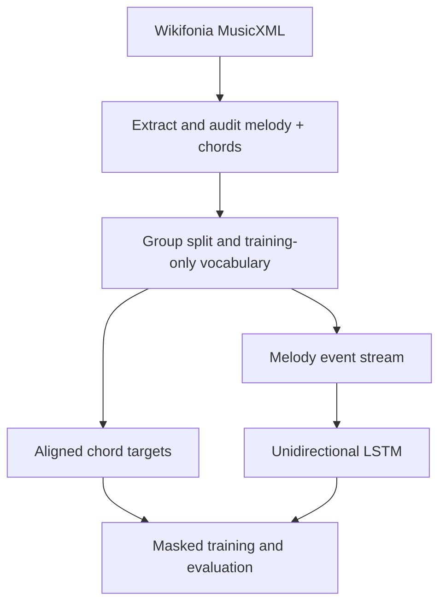

# Melody-to-Chord Harmonisation with a Causal LSTM

Predicting chord labels from a symbolic melody, using only the events available up to the current time.

This is my MSc project in Data Science and Artificial Intelligence at the University of Liverpool. I built a notebook-based workflow for extracting melody and harmony from MusicXML lead sheets, preparing aligned training data, and comparing causal LSTM classifiers. The intended use is an accompaniment tool that can respond while someone plays.

**Python · PyTorch · pandas · NumPy · music21 · MIDITok · scikit-learn**

## Project at a glance

| Question | Approach |
| --- | --- |
| Can a model use melody to predict the current chord without looking ahead? | A two-layer, unidirectional LSTM with a stateful inference interface. |
| How should note events and chord targets be aligned? | A 24-pulses-per-quarter-note grid, with supervision at clock positions. |
| How can the long tail of chord labels be handled? | Training-derived Top-200 and Top-250 vocabularies, with other labels mapped to `<UNK>`. |
| Does class weighting help? | A separate Top-200 experiment changes the training loss while retaining the other experimental settings. |
| How is causality checked? | Future-input perturbation and comparison of full-sequence versus chunked inference. |

The repository contains the research implementation. A browser application, live MIDI connection and audio accompaniment engine are outside this release.

## What I implemented

- **MusicXML preprocessing:** select a lead-sheet part containing both melody notes and chord symbols, expand repeats where possible, consolidate ties, normalise chord labels, and log rejected files.
- **Data-quality checks:** audit quantisation at 12 and 24 PPQ, reject ambiguous or overlapping melodies, and keep filename variants in the same split.
- **Training-data preparation:** select chord vocabularies using the training split only, retain `N` as a semantic no-chord label, and separate input events from gold chord targets.
- **Causal modelling:** convert offline note durations to release events before the model sees them, train a unidirectional LSTM, and carry hidden state through consecutive evaluation windows.
- **Evaluation:** report slot accuracy, Top-3 accuracy, F1, chord-onset accuracy, unweighted cross-entropy, perplexity and unknown-label rates, alongside a majority-chord baseline.

## How the pipeline works



### Why a causal model?

A bidirectional model can use later notes when predicting an earlier chord. That is useful for offline harmonisation, but those notes have not arrived during live playing. Here, a prediction must depend only on the melody events already observed.

Duration tokens pose a similar problem: a completed score tells us how long a note will last, but a live system does not know that at note-on. The training notebooks therefore adapt the offline encoding to `Pitch` at note-on, `NOTE_OFF` at release, and one clock event per grid step. Gold chord labels are supervision only.

For a worked event example and the boundaries of these checks, see [method and evaluation](docs/METHOD.md).

## Experiments

| Run | Retained chord labels | Supervised classes | Classifier outputs | Training objective |
| --- | ---: | ---: | ---: | --- |
| Top-200 baseline | 200 | 201 | 202 | Unweighted cross-entropy |
| Top-250 baseline | 250 | 251 | 252 | Unweighted cross-entropy |
| Top-200 weighted | 200 | 201 | 202 | Class-weighted cross-entropy |

Supervised classes include `<UNK>`. Classifier outputs also include `<PAD>`, which is masked out of the training targets. `N` means no chord and is distinct from `<UNK>`.

The checked-in settings use 128-dimensional embeddings, a hidden size of 128, two LSTM layers, dropout of 0.30 and 512-token windows. Training windows advance by 256 tokens; evaluation windows advance by 512 and retain each song's tail. See [reproducibility](docs/REPRODUCIBILITY.md) for the full configuration.

### Results and evidence

The supplied dissertation archive contains source notebooks with cleared outputs. It does **not** contain the final metric files, trained checkpoints or result figures. This source release therefore makes no numerical claim about predictive performance or measured latency.

The notebooks generate those artifacts when run. [The results directory](results/README.md) explains which files are needed to publish a traceable comparison. The training notebooks expect an accepted corpus of 5,022 songs; this is a compatibility check in the code, rather than a corpus count independently reproduced for this release.

## Explore the code

| File | Purpose |
| --- | --- |
| [01 · Preprocessing and encoding](notebooks/01_Wikifonia_Preprocessing_and_TopN_Encoding.ipynb) | MusicXML extraction, quality control, group splits and training-only vocabulary selection. |
| [02 · Baseline experiments](notebooks/02_Causal_LSTM_Top200_Top250_Baseline.ipynb) | Unweighted Top-200 and Top-250 training, stateful testing and comparison. |
| [03 · Weighted experiment](notebooks/03_Causal_LSTM_Top200_ClassWeighted.ipynb) | Top-200 class-weighted training and comparison with the unweighted run. |
| [Method and evaluation](docs/METHOD.md) | Event timing, model design, metric definitions and limitations. |
| [Reproducibility](docs/REPRODUCIBILITY.md) | Installation, data access, paths and execution order. |
| [Changes from the submission](docs/CHANGES_FROM_SUBMISSION.md) | What was changed when preparing this public copy. |

## Getting started

The notebooks were written for Python 3.12 and Google Colab. For a local environment, run these commands from the repository root:

```bash
python -m venv .venv
```

Activate the environment (`.venv\Scripts\Activate.ps1` in Windows PowerShell, or `source .venv/bin/activate` on macOS/Linux), then run:

```bash
python -m pip install -r requirements.txt -r requirements-dev.txt
python scripts/verify_repository.py
python -m unittest discover -s tests -v
python -m jupyterlab
```

The checks use synthetic inputs and do not download the dataset or train a model. In JupyterLab, follow the [execution sequence](docs/REPRODUCIBILITY.md#execution-sequence): preprocessing for each vocabulary, both baseline runs, then the weighted run. GPU-backed Colab is the practical starting point for full training.

## Limitations and next steps

- Melody does not determine a unique musical accompaniment. Agreement with one annotated chord sequence is only one measure of usefulness.
- Rare chords are merged into `<UNK>`. This reduces label sparsity but loses musical detail; a live product would need a fallback for unknown predictions.
- Filename-based song grouping prevents variants with matching normalised filenames from crossing splits. It does not prove that every duplicate arrangement or composition has been found.
- Chord-onset evaluation follows changes in the mapped labels. A transition can disappear when both original chords become `<UNK>`.
- The notebooks contain a model-only latency benchmark. It excludes input capture, network, audio scheduling and the user interface.
- A listening study, transposition augmentation, broader genre coverage and an end-to-end live prototype would be useful further work.

## Data and acknowledgements

Wikifonia source files and chord-conversion utilities are obtained from [ChoCo](https://github.com/smashub/choco). This project extracts both melody and annotated chords from the same MusicXML file; it does not use JAMS annotations as input. Raw scores, generated datasets and trained weights are excluded from Git.

See [third-party acknowledgements](THIRD_PARTY.md) for upstream links and licence information. This repository does not apply a new software licence to the project author's code.

**Author:** Hao Shen Yang
